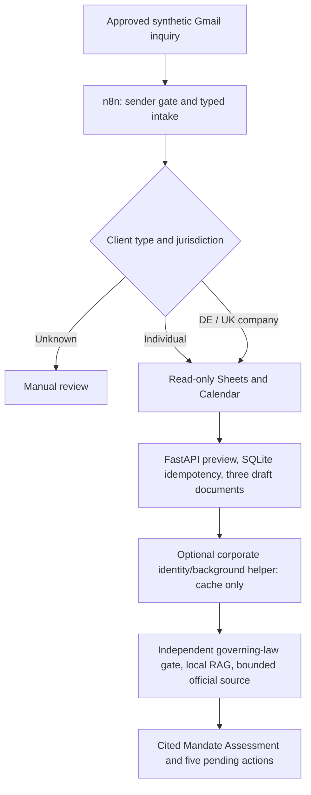

# INCEPT — Legal Client Onboarding & Corporate Intelligence

## Run the INCEPT demonstration

```sh
python -m scripts.gradio_app
```

Open **http://127.0.0.1:7860**. The fixed fictional German-company scenario shows the complete Mandate Assessment, three document drafts, validation/missing information and five pending lawyer actions. **Run DEMO through n8n** uses the real local n8n → FastAPI structured-intake path; **Load saved DEMO fixture** is explicitly labeled and works without n8n or paid APIs. No AI/provider request or external action is needed. The advance remains unissued.

[Setup and actual verification](docs/gradio_demo.md) · [5–7 minute presentation](docs/demo_script.md) · [Project 3 evidence checklist](PROJECT3_SUBMISSION_CHECKLIST.md).

Experimental source-exact AI synthesis v2 is offline-tested and separate from this reliable deterministic demo. The last live synthesis was rejected; no accepted live AI report is claimed.


**Implementation boundary:** the validated canonical workflow remains deterministic. A separate, optional OpenAI synthesis helper and development workflow are implemented and offline-tested with mocks. **No accepted live AI assessment has been verified.** Earlier model responses were rejected by validation. Billing/approval flags and budgets default to blocking requests. Project 3 rubric compliance remains to be confirmed.

**Legal Tech / Corporate Law.** An Ironhack Project 3 development MVP for law firms and legal professionals. n8n orchestrates approved inquiry intake; Python/FastAPI supplies typed processing, evidence checks, local RAG and deterministic German draft documents.

INCEPT supports individual and corporate intake, German OpenRegister and UK Companies House identity research, bounded Tavily Search, source-linked Mandate Assessments, and jurisdiction-aware legal guidance. Documents are a **Rechtsanwaltsvollmacht**, **Vergütungsvereinbarung** and **Vorschussanforderung**, generated by engine **v2.0.0**. All actions remain pending lawyer approval. No email, calendar event, payment demand or invoice is automatically issued.

## Architecture



Company jurisdiction does not establish governing law or authority to instruct. German and UK adapters are preserved; the canonical corporate helper never calls providers on a cache miss. The bounded fixture planner retains identity, litigation and regulatory topics. **Financial statement retrieval, annual-account parsing, ratios and M&A financial analysis have been retired.**

## Current verification

| Capability | Evidence / limit |
|---|---|
| Real Gmail → Sheets → Calendar → FastAPI → German source → v2 documents | Execution **28**, review-ready result; 37-node manual workflow |
| German/UK corporate routing and individual/ambiguous paths | Offline mocked coverage; fixture n8n executions 20–23 |
| Real UK subject/counterparty identity | Execution **26** evidence: one fresh Companies House profile lookup before intake; not a fresh registry call within the graph |
| Tavily Search | One separately authorized Basic Search, three real sources; local report integration, no new n8n execution |
| Document engine v2.0.0 | Versioned templates, 32 official source records, validation and issuance blockers; not professional legal approval |
| UK substantive legal analysis | Unverified; lawyer review required; no automatic BGB application |
| Separate counterparty orchestration | Demonstrated in the isolated execution-26 test; not a general typed counterparty branch in the canonical export |
| Optional AI mandate synthesis | Strict structured output, supplied citations/exact quotes, conditional analysis and explicit fallback. V2 is offline-tested; the last live synthesis was rejected in execution 34. [Details](docs/ai_synthesis.md) |
| Gradio interface | Implemented and verified through real local n8n execution **38**; explicit saved-fixture fallback |
| External action executor | Not implemented; five actions remain pending lawyer approval |

[Live evidence](docs/live_integration_evidence.json) · [Execution 28](docs/incept_live_documents_v2.md) · [Tavily evidence](docs/tavily_live_validation.json). No fixture is presented as a live response.

## Install and run locally

Python 3.11+, Node.js for offline workflow-code tests, and n8n (validated version 2.47.3) are required. Provider keys are unnecessary for fixtures and offline generation.

```sh
python -m venv .venv
source .venv/bin/activate
python -m pip install -r requirements.txt
python -m unittest discover -s tests -q
python -m scripts.document_examples
python -m scripts.incept_corporate_demo
```

To create a local configuration, copy `.env.example` only if `.env` does not already exist; fill values privately. Existing credentials must not be overwritten. Defaults are development/fixture mode with paid access disabled. A valid key does not authorize spending.

Launch the canonical development helper on loopback port 8003:

```sh
python -c "import uvicorn; from scripts.http_service import create_app; uvicorn.run(create_app(development=True, service_token=None, allow_paid=False), host='127.0.0.1', port=8003, access_log=False)"
```

```sh
curl --fail-with-body -sS http://127.0.0.1:8003/v1/onboarding/preview \
  -H 'Content-Type: application/json' \
  --data-binary @examples/documents/corporate/input.json
```

The loopback example is not production authentication. `scripts.http_service:app` is the environment-configured deployment entry point; existing `LEGALFLOW_SERVICE_*` and service-header names remain for compatibility. [API/budget reference](docs/api_usage.md).

## Canonical n8n workflow and safe demo

**Canonical export:** [workflows/incept_live_documents_v2.json](workflows/incept_live_documents_v2.json). It preserves execution-28 logic, the UK guidance guard and v2 document checks. Account/spreadsheet fields are placeholders; OAuth bindings, webhook IDs and private executions are excluded. It is manual-only and inactive.

[Import and binding instructions](docs/incept_live_documents_v2.md). Existing local workflows are not changed by code publication. Import as a separate inactive copy, bind existing compatible project credentials and configure only the dedicated synthetic account. A new live run or email requires explicit authorization; do not send another message merely to replay a prior test. [5–7 minute safe demo](docs/demo_script.md).

A separate [40-node AI development export](workflows/incept_ai_synthesis_dev.json) adds optional synthesis and validation after evidence assembly. It is inactive, manual-only and not imported into the running instance. Defaults produce an explicit unavailable/fallback response. Follow the [AI setup, billing gates and limitations](docs/ai_synthesis.md); importing an export does not authorize Google or model requests.

## Samples, documents and safeguards

- [Individual Mandate Assessment](examples/reports/individual_mandate_assessment.md)
- [German corporate Mandate Assessment](examples/reports/germany_company_mandate_assessment.md)
- [UK corporate Mandate Assessment](examples/reports/uk_company_mandate_assessment.md)
- [German legal-document bundles and validation](examples/documents/README.md)
- [Synthetic mock AI assessment examples](examples/ai_synthesis/README.md) — hand-authored mocks, not live reasoning proof
- [Synthetic email payload](examples/incept_approved_demo_inquiry.txt) (exact subject documented in workflow setup)

Reports and inputs above are explicitly synthetic. The two document bundles cover different principal/representative cases. They intentionally omit genuine fiscal identifiers, invoice numbers and payment credentials. Decimal arithmetic remains **5 × EUR250 net + supplied 19% demo VAT = EUR1487.50**; unknown tax leaves VAT/gross unresolved. No blanket 19% assumption applies.

The document/approval gates distinguish data completeness from legal readiness. Templates and individual drafts require lawyer review; representative authority, conflicts, fee applicability and tax/e-invoice requirements remain professional decisions. Markdown/PDF appearance does not establish structured e-invoice compliance. Saved previews retain their original content and idempotency fingerprints.

`.env`, raw emails, execution payloads, signed URLs, provider caches, databases, private backups and runtime reports are ignored. Private evidence for executions 26/28 remains local. Pattern-based secret scans are not an absolute security guarantee.

## Reviewer map

- [Optional AI synthesis contract and offline demo](docs/ai_synthesis.md)
- [Architecture and route boundaries](docs/architecture.md)
- [Document architecture and maintenance](docs/legal_document_generation.md)
- [32 official source records](docs/legal_document_sources.md)
- [Curated reference scope](references/README.md)
- [API usage and security](docs/api_usage.md)
- [Primary-stack decision](docs/stack_decision.md)
- [Project 3 checklist](PROJECT3_SUBMISSION_CHECKLIST.md)
- [GTM future sprints](gtm_future_sprints.md)
- [Cleanup inventory and dependency decisions](docs/repository_cleanup_inventory.md)

INCEPT evolved from LEGALFLOW. Its reusable identity/research work and Git history are preserved; obsolete financial prototypes are recoverable through Git rather than retained in an archive. Existing Python module names are retained where they still serve active dependencies.

AI synthesis audit repairs: [server provenance, bounded issue support, and immutable approval states](docs/ai_synthesis_audit_repairs.md). Offline mocks do not establish live reasoning quality or legal approval.
