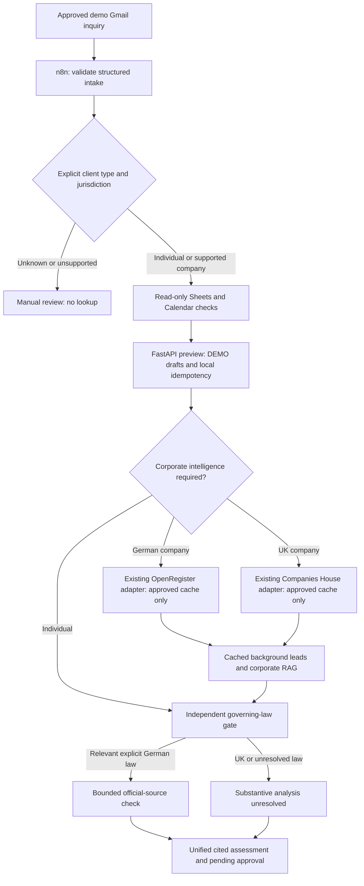

# INCEPT — AI-Powered Legal Client Onboarding & Corporate Intelligence

**Industry: Legal Tech / Corporate Law.**

INCEPT turns an explicitly approved fictional inquiry into a reviewable matter
bundle: cited Mandate Assessment, DEMO Vollmacht, hourly-fee agreement, five-hour
advance draft and lawyer-approval queue. n8n owns the orchestration; Python/FastAPI
provides typed processing, local storage, evidence checks and bounded research.

This is an Ironhack Project 3 development MVP, not a production legal service.
The repository and historical Python modules retain the LEGALFLOW name.

## Main capabilities

- Autonomous approved-inquiry intake orchestrated by n8n, with explicit individual, company or unresolved classification.
- German and UK corporate intelligence through the existing OpenRegister and Companies House adapters; the new intake path uses approved cached evidence only.
- Evidence-backed Mandate Assessment reports, jurisdiction-aware legal research and local RAG, with source dates and missing-information warnings.
- Personalized DEMO Vollmacht, hourly-fee agreement and a deterministic five-hour advance invoice draft.
- FastAPI processing and read-only Gmail, Google Sheets and Google Calendar integrations, with human approval before any external action.

| Capability | Evidence/status |
| --- | --- |
| Approved Gmail → Sheets lookup → Calendar metadata → onboarding → official legal source → report | **VERIFIED:** actual n8n execution 19; review-ready bundle, 12 sources, three drafts, five pending actions |
| Three real Google integrations | **VERIFIED:** independent executions 12–14 and integrated execution 19 |
| Primary-source research | **VERIFIED, bounded:** official BGB §286(1)/(4), exact wording, source hash and retrieval timestamp; not a verified finding about the debt |
| Local RAG and source attribution | **IMPLEMENTED:** curated references, uncertainty and source IDs; review dates are not enactment dates |
| Individual/company routing and optional German/UK corporate intelligence | **FIXTURE VERIFIED:** four real n8n executions 20–23 using synthetic ingress/Google data and real local helpers; no live registry verification |
| OpenRegister / Companies House / Tavily reuse | **CACHE-ONLY in new intake path:** no cache-miss network request or financial endpoint permitted |
| Tavily Basic Search | **LIVE VERIFIED:** one approved basic request, three real sources, local evidence/report integration; [sanitized proof](docs/tavily_live_validation.json). No new n8n execution |
| UK substantive legal assessment | **NOT VERIFIED:** requires lawyer review; no automatic German BGB application |
| Real sending, scheduling, billing or approval execution | **DISABLED / NOT IMPLEMENTED** |
| Gradio | **PLANNED**, separate next milestone |

## Architecture and routing



Company registration jurisdiction does not establish governing law, signing
mandate or professional conflict clearance. Corporate provider failure is visible
and nonblocking. Unknown client type/jurisdiction stops the new workflow for review.
Financial retrieval, annual accounts and ratios are deliberately excluded from
the new corporate-intake path; historical modules remain available separately.

## Install and reproduce offline

Use Python 3.11+ and Node.js for JavaScript workflow regression checks. The actual
live demo used n8n 2.47.3. No dependency installation authorizes paid API access.

```sh
python -m venv .venv
source .venv/bin/activate
python -m pip install -r requirements.txt
python -m unittest discover -s tests -q
python -m scripts.onboarding_demo
python -m scripts.incept_corporate_demo
```

Offline demos block external sockets and use temporary SQLite stores. They create
local artifacts under ignored `reports/`; they do not execute Google/provider APIs.
Two distinct system-generated sample assessments are included for review:

- [Individual service dispute](examples/reports/individual_mandate_assessment.md)
- [German corporate mandate](examples/reports/germany_company_mandate_assessment.md)
- [UK corporate mandate](examples/reports/uk_company_mandate_assessment.md)

All three are explicitly synthetic **offline** examples, not invented live runs.

## API and workflows

Original fixture service / proven workflow: port **8002**. New isolated corporate
development copy: port **8003**, using the same application code. Leave successful
workflows unchanged. Launch a local development helper when needed:

```sh
python -c "import uvicorn; from scripts.http_service import create_app; uvicorn.run(create_app(development=True, service_token=None, allow_paid=False), host='127.0.0.1', port=8003, access_log=False)"
```

```sh
curl --fail-with-body -sS http://127.0.0.1:8003/v1/onboarding/preview \
  -H 'Content-Type: application/json' --data-binary @examples/onboarding_preview.json
```

Relevant endpoints:

- `POST /v1/onboarding/preview`: typed intake, deterministic drafts and local SQLite idempotency.
- `POST /v1/onboarding/corporate-intelligence`: optional typed identity/background assessment; source policy and zero-request budget enforced.
- `POST /v1/onboarding/research/verify`: verify orchestrator-retrieved official source and enrich the assessment without helper network I/O.

Import sanitized JSON through n8n **Import from File** as a new inactive workflow.
Exports contain no credentials; bind existing compatible credentials in the local
instance. No repeat OAuth setup is needed for already imported workflows.

| Workflow | Purpose |
| --- | --- |
| [Integrated intake](workflows/incept_autonomous_intake_dev.json) | Proven workflow FeRkXfcrj8dceBZh, execution 19 |
| [Corporate development copy](workflows/incept_corporate_intake_dev.json) | New optional corporate routing; imported as 0zruCCbLGNUZJ8Gt, inactive, not live-executed |
| [Onboarding](workflows/legal_intake_onboarding.json) | Original isolated preview flow |
| [Sheets](workflows/incept_google_sheets_read_test.json), [Gmail](workflows/incept_gmail_read_test.json), [Calendar](workflows/incept_calendar_read_test.json) | Read-only integration tests |

See [corporate integration setup](docs/incept_corporate_intelligence.md) and
[the approved-email contract](docs/incept_autonomous_intake_dev.md). The old email
without an explicit client type correctly requires review in the **new** workflow;
the original workflow and its input remain unchanged.

## Configuration and safeguards

`.env` and runtime stores are private and ignored. Provider keys (OpenRegister,
Companies House, Tavily, OpenAI) are for historical optional integrations; the new
corporate path does not use them on a cache miss. n8n OAuth credentials stay in
n8n and are referenced by metadata only. No credential values belong in exports.
The optional `N8N_API_KEY` and `N8N_BASE_URL` support local administrative import
and evidence checks; never publish their values.

The preview accepts an explicit synthetic-data acknowledgement and `.invalid`
email addresses. A repeated identical idempotency key returns the stored matter;
changed input with the same key returns 409. Legacy fingerprints are retained.
These controls are a local demo, not production authentication or tenant isolation.

Five-hour draft arithmetic is Decimal: **5 × supplied net hourly rate**, rounded
VAT from an explicitly supplied treatment/rate, then gross. Unknown VAT remains
unavailable; no tax eligibility, tax ID, invoice number or completed work is invented.
No message, spreadsheet row, event or invoice is issued by this path.

For GitHub presentation and publication scope, see [repository presentation](docs/github_presentation.md).

## Evidence, limitations and project status

Execution 19 and its private generated artifacts remain in
`reports/incept_execution_19/`. Raw mail, traces, SQLite, caches, signed URLs and
user records are not submission artifacts. Source wording verification is not
verification of case allegations. All deadlines remain unconfirmed and all actions
pending lawyer approval. Cached corporate records are not treated as current.

- [Architecture](docs/architecture.md)
- [Corporate integration and four scenarios](docs/incept_corporate_intelligence.md)
- [Primary-source verification](docs/incept_primary_source_research.md)
- [Live document-engine checkpoint: execution 28](docs/incept_live_documents_v2.md)
- [German legal document generation v2](docs/legal_document_generation.md)
- [Document quality audit](docs/legal_document_quality_audit.md)
- [Project 3 checklist](PROJECT3_SUBMISSION_CHECKLIST.md)
- [Stack decision](docs/stack_decision.md)
- [5–7 minute demo](docs/demo_script.md)
- [GTM future sprints](gtm_future_sprints.md)

## Repository map

`workflows/` holds sanitized graphs; `scripts/` contains reusable services and
adapters; `references/` contains curated guidance and labeled demo evidence;
`examples/` contains synthetic inputs/reports; `tests/` is offline; `docs/` explains
implementation/evidence. `data/` and `reports/` remain local runtime/output stores.

## Legacy LEGALFLOW — M&A due diligence research

LEGALFLOW began as corporate M&A diligence. Its reusable identity, evidence,
research and reporting modules are retained, not deleted or renamed. Financial
experiments remain historical and isolated. The original architecture combined registry search/detail verification, Tavily research, deterministic evidence and financial analysis, local RAG and sourced report rendering. Those modules, tests, workflows and Git history are preserved; financial endpoints are excluded from INCEPT intake. [Prior root documentation is archived](docs/legacy_legalflow.md).


## Isolated n8n validation (2026-11-11)

Four separate inactive fixture test copies executed successfully in n8n: individual **20**, German company **21**, UK company **22**, ambiguous **23**. The first three produced review-ready bundles; the ambiguous case stopped at NEEDS_REVIEW. Google ingress/read operations and legislation retrieval were explicitly substituted, while local onboarding, adapters, evidence checks and report assembly ran for real. Company fixtures remain UNVERIFIED; these executions do not establish live registry or new Google connectivity. Original corporate workflow 0zruCCbLGNUZJ8Gt and proven FeRkXfcrj8dceBZh remain unchanged.

Sanitized trace summary: [execution evidence](docs/incept_corporate_n8n_validation.json). Full local artifacts: `reports/incept_corporate_n8n_validation/`. Regression suite: **285 passing tests**. Gradio remains planned.
