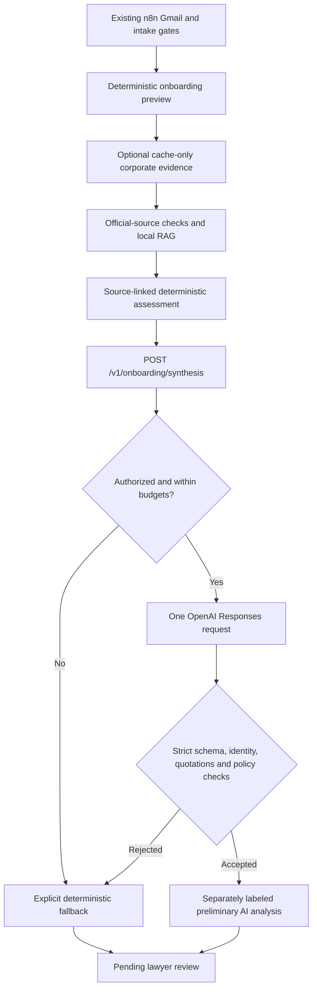

# Controlled AI mandate synthesis

## Status and scope

Implemented: a callable OpenAI Responses API adapter, strict structured response contract, evidence validation, persistent request/token reservations, explicit fallback, FastAPI helper and a separate inactive 40-node n8n export. All validation in this change uses synthetic cases and mocked LLM/HTTP responses. The full suite passes 233 tests, including 44 synthesis/audit regressions; [sanitized validation record](ai_synthesis_validation.json). **No genuine live model execution or billing verification occurred.** Passing mock tests does not demonstrate real model reasoning quality or professional legal correctness.

Previously the active application used rule-based intake parsing, FTS5 reference retrieval, source wording checks and templates only. The new model call is genuine callable code, not a fixture substituted into production. The demo injects a hand-authored mock transport explicitly; mock outputs say `execution_mode: mock`, `model_used: false`, `live_request: false`. There is no HTTP parameter that selects a mock provider or authorizes spending.

The official SDK is already installed locally (3.46.0); `requirements.txt` includes `openai>=3.46.0,<4`. Implementation follows [official Structured Outputs documentation](https://developers.openai.com/api/docs/guides/structured-outputs). A strict JSON schema constrains syntax; local checks remain necessary for provenance and safety.

## Architecture and endpoint



The existing atomic preview already generates/persists protected v2 documents. This release deliberately keeps that sequence: synthesis follows evidence assembly and cannot modify those documents. Moving initial document generation behind AI would require changing the working preview contract; it is not done here. AI assessment output remains independent of document terms, validation, five-hour arithmetic, idempotency and the five approval-pending actions.

`POST /v1/onboarding/synthesis` accepts `{"bundle": <OnboardingBundle>, "corporate_result": <CorporateResult or null>, "primary_research": <verified PrimaryResearchResult or null>}`. It returns status, reason, execution mode, model-use/request flags, configured model, evidence fingerprint, typed synthesis or null, assessment, cache flag, token reservation metadata and optional provider token usage. `Cost unknown` and `billing_confirmed: false` distinguish token estimates from billing. `live_request` denotes a live transport attempt, not proof of successful provider execution. A validated live result reused from cache retains `model_used: true`, with `live_request: false` and `cache_hit: true`.

FastAPI keeps synthetic-only intake and its existing service-key header. Enabling AI requires a nonempty service token even in development; unauthorized callers cannot reach synthesis. API bodies cannot change model, approval or budgets. The default is unavailable/fallback, with no provider request.

## Output contract

`AISynthesis` has immutable case identity/role context (`client_id`, `matter_id`, `client_name`, opposing parties, governing law, mandatory lawyer-review flag) and nine sections:

1. Mandate summary.
2. Factual background.
3. Preliminary legal issues.
4. Source-supported analysis.
5. Corporate intelligence observations.
6. Missing information.
7. Uncertainties and limitations.
8. Questions requiring lawyer review.
9. Proposed next steps.

Every statement includes `statement`, an evidence-status enum, supplied `source_ids`, exact `evidence_quotes`, a controlled `issue_category`, an `assertion_type`, and the fixed `action_state: not_performed_pending_lawyer_approval`. Four mandatory top-level fields (`mandate_accepted`, `documents_approved`, `invoice_issued`, `external_actions_executed`) must be false. The API returns server-derived `validated_issue_categories`; n8n checks category membership and immutable states. Unknown fields, invented IDs, absent quotes, case/role changes and evidence-status escalation fail validation. Summary/factual/corporate statements are extractive. New legal reasoning must cite both case evidence and applicable guidance, and must be conditional (`If … may/could …`); other generated recommendations/issues are questions. No generated dates, unsupported statutory references, court holdings, liability/authority confirmation, conflict clearance or action instructions are accepted. Lack of applicable legal guidance requires abstention from legal analysis. Registry-only RAG cards do not establish substantive governing law.

Reports distinguish unverified intake, checked reference guidance, cached provider reports, unverified leads, conditional AI analysis and deterministic missing evidence. Original timestamps and source records remain unchanged. Explicit client allegations are labeled CLIENT-ALLEGED, never independently verified. Historical official company-status excerpts are attributed separately and cannot establish misconduct. Coverage limitations are rendered deterministically even if the model's discussion is weak. Failed, incomplete, refused, invalid or unavailable responses retain the deterministic report with **AI analysis unavailable**; they do not become verified conclusions.

## Grounding and untrusted content

The packet projects only necessary client/matter identity, scope, opposing-party roles, supplied sources and uncertainty. It excludes contact details, draft document bodies, fee arithmetic and action execution controls. Selected legal cards must match the local corpus exactly; primary BGB wording must match reviewed provision text. Primary-research events require a private server receipt created by the existing research-verification endpoint. The receipt binds the case, exact checked wording, source IDs, digest and original retrieval metadata. It attests server-checked submitted wording, **not independent HTTP acquisition**. Older results without receipts cannot be promoted automatically. Corporate role/identity context must match the bundle. The server re-derives evidence from its fixture catalogue or typed corporate cache, comparing source identifiers, original timestamps, freshness and verification flags. Caller-modified labels or dates are rejected; insufficiently sourced legacy cache entries cannot establish provenance. Synthetic evidence stays synthetic. Exact legal URLs, dates and metadata must match the local corpus or receipt; future dates fail validation. Relevant corporate RAG references are validated against their known corpus and registration jurisdiction, separately from substantive governing law. Synthesis does not refetch or independently attest acquisition of submitted evidence.

Namespaced projection IDs prevent altered quote text from masquerading as an original assessment source. Original source IDs, dates and URLs remain traceable. Safe URLs are displayed as links, never fetched by the model. Model prose is escaped in Markdown.

System instructions treat every evidence field as untrusted data. Suspicious instruction patterns block synthesis before transport. No model tools, arbitrary URLs, functions, previous-response state or external action executor are available. Schema and post-validation reject injected approval/contract fields and fabricated evidence. **These are defense-in-depth measures, not a proof against every prompt injection or unsupported inference.** Exact quote/citation checks prove attribution, not semantic entailment. Real model behavior, false-positive rejection rates and usefulness still require an authorized evaluation and lawyer review.

## Budgets and live approval

`.env.example` contains safe defaults; `.env` is not changed. Model selection is deliberately blank rather than guessing availability or price.

| Variable | Default / requirement |
|---|---|
| `OPENAI_API_KEY` | Private existing API credential; never included in evidence |
| `INCEPT_AI_MODEL` | Blank; choose an account-accessible Responses/Structured Outputs model after checking current availability and price |
| `INCEPT_AI_LIVE_ENABLED` | `0` |
| `INCEPT_AI_BILLING_VERIFIED` | `0`; only the operator may affirm this after actual account verification |
| `INCEPT_AI_APPROVAL_ID` | Blank; fresh explicit user authorization identifier |
| `INCEPT_AI_MAX_REQUESTS` | `0`; authorized request ceiling |
| `INCEPT_AI_MAX_INPUT_TOKENS` | `32000`; conservative UTF-8-byte-based input reservation including schema, instructions and framing allowance |
| `INCEPT_AI_MAX_OUTPUT_TOKENS` | `3000`; sent as provider output ceiling |
| `INCEPT_AI_MAX_TOTAL_TOKENS` | `0`; cumulative reserved-token ceiling per approval |
| `INCEPT_AI_TIMEOUT_SECONDS` | `20`; permitted range 1–60 |
| `LEGALFLOW_SERVICE_TOKEN` | Required when AI is enabled; configured privately |

Existing provider approval flags do not enable AI. AI approval does not enable registry/Tavily/financial requests. No API prices are hardcoded. Byte-based input reservations are conservative estimates, not provider-confirmed token counts or a monetary guarantee. Actual token usage is reported when available; account charges remain unknown.

A private SQLite ledger under ignored `data/ai_synthesis/` reserves request/token budgets transactionally before transport. Duplicate input/model/mode fingerprints reuse validated output. Failed/pending attempts never retry automatically, including after restart or interruption; their full reservations remain spent. Concurrent workers cannot reserve the same operation twice. Model, prompt/schema policy and budget settings cannot silently change under an existing approval ID. Storage errors fail closed. Mock and live keys are separated. SDK retries and redirects/proxies are disabled; no fallback model or provider is tried.

**A future live test requires** checking the API account's actual billing arrangement, model availability/pricing and spending allowance, then receiving explicit approval for a model/request/token budget before setting these flags privately. ChatGPT Plus is not treated as API credit. No credit purchase, auto-recharge change or billing call is performed here. Do not start a live test just to discover billing status.

## Reproduce offline

From the normal installed backend environment:

```sh
python -m unittest discover -s tests -q
python -m scripts.ai_synthesis_demo
python -m scripts.incept_ai_workflow
```

Demo output: `reports/incept_ai_synthesis_mock/` (ignored). Four synthetic scenarios cover individual, German corporate, UK corporate and ambiguous intake. Two curated [mock reports](../examples/ai_synthesis/README.md) are committed; they are not evidence of actual model reasoning.

For a default-disabled HTTP smoke test, first create a normal preview using the [existing setup](../README.md), then submit its saved JSON as the `bundle` field to `/v1/onboarding/synthesis`. Expect a typed `unavailable` result, not a provider call. Automated tests exercise the enabled path using injected mocks and the actual HTTP/JavaScript contracts. The SDK wire-format test uses HTTPX interception, not a real API.

## n8n export

New file: `workflows/incept_ai_synthesis_dev.json` — 40 nodes, manual-only and inactive. It preserves the first 37 canonical nodes and adds POST AI Mandate Synthesis → Validate AI Synthesis Response → AI Final Mandate Report. Only the new export is generated; the canonical file and running workflows stay untouched.

Import as a separate inactive copy only when authorized. Existing Google bindings/account/spreadsheet placeholders need the normal dedicated-demo configuration. Running it would contact those Google services; offline tests do not do so. Enabling AI additionally requires a private service-key header on the synthesis HTTP node. A service-authenticated backend may also require that header on the existing helper nodes. The exported file contains no credentials, account identifiers, approval identifiers or tokens.

The output validator checks identity/roles, citations/quotes, original provenance, assessment flags and unchanged deterministic fields. It replaces only the assessment; original documents, amounts and proposed actions remain untouched. Errors route to an explicit unavailable result with the deterministic assessment and pending lawyer review. Top-level execution accounting includes known potentially billable AI attempts (including failed attempts); transport-unknown outcomes remain null rather than falsely reporting zero. Original preview-bundle counters remain unchanged because the preview itself made no model call. No token/call estimate confirms billing. No fresh n8n execution or live AI success is claimed.

## Ironhack and remaining validation

The original assignment/grading rubric was not found in the inspected project/document/download locations. The locally available “Project 3: Four Example Ideas (Student Board)” illustrates LLM-written reports, but does not establish a formal requirement. Formal compliance remains unconfirmed. This implementation adds real callable synthesis capability; it does not claim a live model demonstration.

Before a live demonstration: verify billing and approve a bounded test, configure a suitable model and authenticated helper, bind the separate inactive workflow, evaluate actual model reasoning/citation quality and rejection behavior, and have a lawyer assess output quality. Production tenancy/privacy controls, legal approval and action execution remain out of scope. Gradio can be developed against the typed disabled/mock contract, but must not advertise live AI until verified.

## Audit repairs and controlled issue support

See [repair evidence and limitations](ai_synthesis_audit_repairs.md). Server-derived categories cover intake, payment disputes, representation, conflicts, corporate identity, jurisdiction, missing evidence, historical corporate status, and five narrowly defined adverse-allegation families. A citation to general law does not support a case allegation. Material adverse output requires a specific, complete supporting case-evidence sentence; factual output must reproduce it with its original attributed status. Free adverse hypotheses are rejected. Supported allegation questions require explicit uncertainty and lawyer review. Detected contradictions require both supporting and denying excerpts in an uncertainty question. Recognized issues outside the controlled scope abstain before model execution.

Approval/issuance assertions are checked in English and German, including inverted questions and quoted evidence. These conservative lexical checks may reject legitimate wording and may miss unfamiliar paraphrases. **Neither the taxonomy nor text checks establish full semantic correctness.** Fixed action states, separate document paths, no action executor, source-specific excerpt checks and mandatory professional review remain necessary.

Provenance rejection, unsupported issue/adverse content, and approval-language rejection have separate fallback reasons. The original deterministic assessment and documents remain unchanged, with explicit review warnings; retaining a submitted baseline does not validate its provenance. The separate n8n export preserves these warnings. Failed attempts retain reservations and never retry automatically. The changed schema/prompt fingerprint requires fresh authorization rather than silently reusing an old approval; existing ledgers are not reset or migrated.
