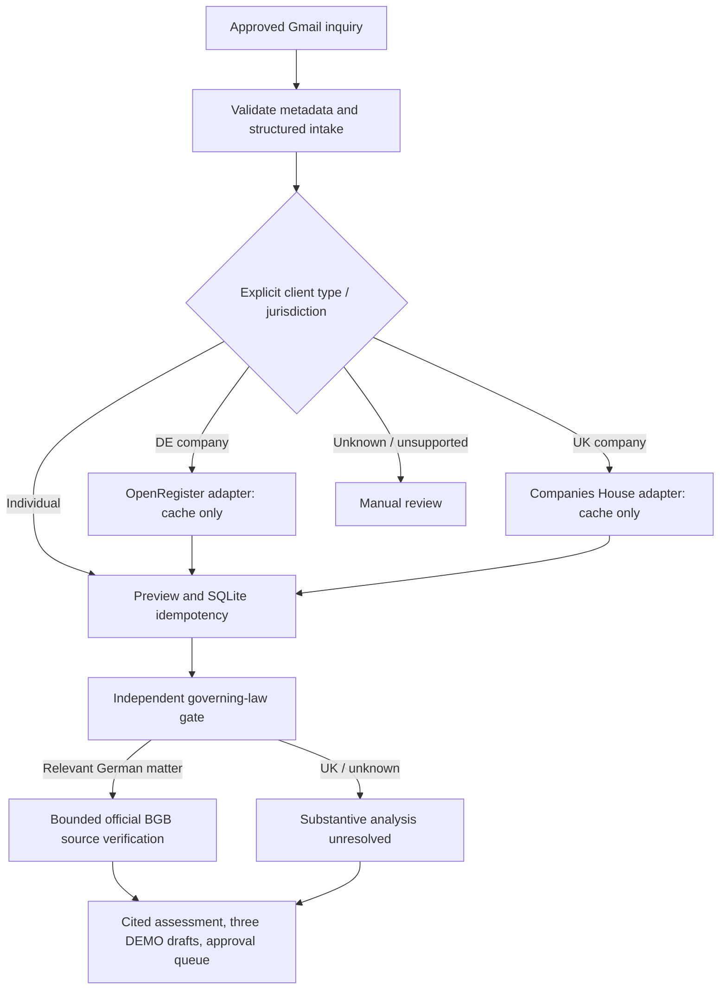

# INCEPT architecture

n8n is the orchestrator. FastAPI is a typed local helper, not an autonomous external-action executor.

The actual new graph prepares the preview before the optional corporate helper, then merges corporate evidence into its final report. Provider failure is nonblocking. Sheets and Calendar remain read-only intake checks. No corporate cache miss can invoke a provider callback. Financial endpoints are excluded.

Reusable boundaries: `scripts/company_service.py` verifies details and registration; existing OpenRegister/Companies House adapters perform schema conversion; `scripts/company_research.py` builds bounded queries; `scripts/evidence_validator.py` classifies evidence; `scripts/local_rag.py` retrieves jurisdiction-filtered guidance; `scripts/report_renderer.py` escapes report values. `scripts/corporate_intelligence.py` applies a zero-network cache policy around those components.

Identity jurisdiction does not select applicable law. The new workflow requires explicit governing law before German substantive research. UK/unknown substantive analysis remains unverified. Registry consistency neither proves authority to instruct nor replaces professional conflicts checks.

The existing fixture-only research planner remains unchanged. The new helper bounds cached operations to three and external operations to zero. Gradio and approval execution are future work.

See [setup and evidence policy](incept_corporate_intelligence.md).
