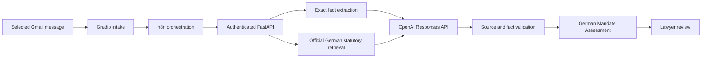

# INCEPT architecture

The active product is a German-law legal intake assistant. It reads the message selected in Gmail and prepares a preliminary Mandate Assessment for a lawyer.

The intake is one optional-field structure: client name, contact email, address, counterparty, original inquiry text, relevant dates/amounts/documents found in the source, and requested assistance. Unknown values remain unknown. Company names are plain text.

OpenAI uses `gpt-4o-mini` through the existing Responses API integration. It receives selected inquiry excerpts and verified German legal excerpts, has no tools, and cannot send messages or generate documents. The server checks exact source excerpts and citations, case identity, legal-source provenance, allowed conditional language, and prohibited deadlines or approvals. These checks establish provenance and bounded output rules; they do not establish semantic correctness or replace lawyer review.

Optional document drafting and Gmail replies remain separate workspace actions. Document release requires lawyer review; sending requires a preview and explicit confirmation, and duplicate-send protection remains active.

Companies House, company classification, jurisdiction routing, and corporate-research endpoints are not exposed by the active FastAPI intake app. Their modules, historical workflows, tests, and execution evidence are retained as archive material; they are not on the current Gmail Analyze path.
