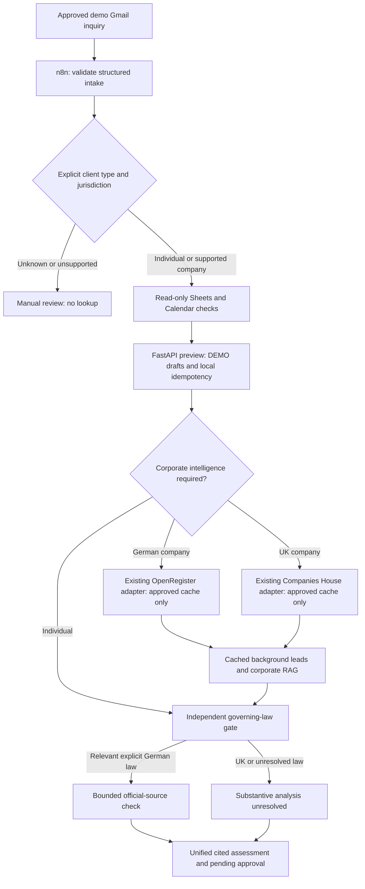

# INCEPT architecture

**AI-Powered Legal Client Onboarding & Corporate Intelligence — Legal Tech / Corporate Law.**

n8n is the orchestrator. FastAPI is a typed local helper, not an autonomous external-action executor.

The actual new graph prepares the preview before the optional corporate helper, then merges corporate evidence into its final report. Provider failure is nonblocking. Sheets and Calendar remain read-only intake checks. No corporate cache miss can invoke a provider callback. Financial endpoints are excluded.

Reusable boundaries: `scripts/company_service.py` verifies details and registration; existing OpenRegister/Companies House adapters perform schema conversion; `scripts/company_research.py` builds bounded queries; `scripts/evidence_validator.py` classifies evidence; `scripts/local_rag.py` retrieves jurisdiction-filtered guidance; `scripts/report_renderer.py` escapes report values. `scripts/corporate_intelligence.py` applies a zero-network cache policy around those components.

Identity jurisdiction does not select applicable law. The new workflow requires explicit governing law before German substantive research. UK/unknown substantive analysis remains unverified. Registry consistency neither proves authority to instruct nor replaces professional conflicts checks.

The fixture-only corporate planner retains identity, litigation and regulatory topics; the discontinued financial topic is rejected. The new helper bounds cached operations to three and external operations to zero. Gradio and approval execution are future work.

See [setup and evidence policy](api_usage.md).

## Verification boundaries

Execution 19 proves the approved German demo used the real Google integrations and bounded official-source research. Executions 20–23 prove separate inactive n8n copies process four synthetic scenarios through real local helpers; their Google and legislation nodes are fixture substitutions. These are distinct claims. Corporate source consistency is not fresh registry verification, a conflicts check or authority to instruct. The original imported corporate workflow remains unchanged; corrected development exports and isolated copies contain the UK guidance-validation fix.

Historical LEGALFLOW M&A research and financial modules remain preserved and outside the INCEPT intake path. Gradio is planned, not implemented.
