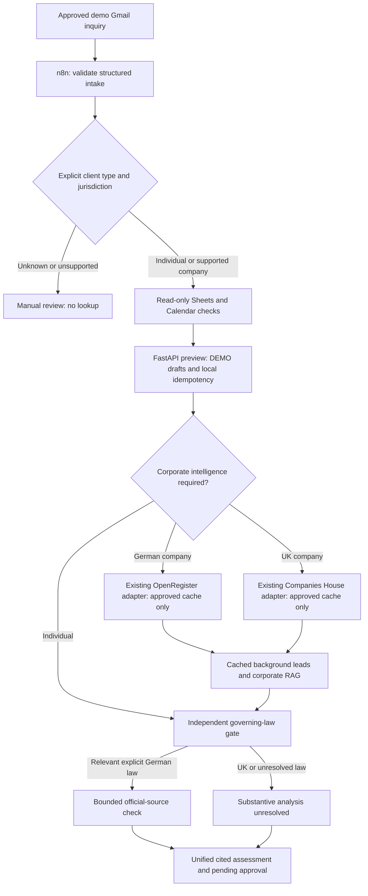

# INCEPT architecture

**AI-Powered Legal Client Onboarding & Corporate Intelligence — Legal Tech / Corporate Law.**

n8n is the orchestrator. FastAPI is a typed local helper, not an autonomous external-action executor.

The actual new graph prepares the preview before the optional corporate helper, then merges corporate evidence into its final report. Provider failure is nonblocking. Sheets and Calendar remain read-only intake checks. No corporate cache miss can invoke a provider callback. Financial endpoints are excluded.

Reusable boundaries: `scripts/company_service.py` verifies details and registration; existing OpenRegister/Companies House adapters perform schema conversion; `scripts/company_research.py` builds bounded queries; `scripts/evidence_validator.py` classifies evidence; `scripts/local_rag.py` retrieves jurisdiction-filtered guidance; `scripts/report_renderer.py` escapes report values. `scripts/corporate_intelligence.py` applies a zero-network cache policy around those components.

Identity jurisdiction does not select applicable law. The new workflow requires explicit governing law before German substantive research. UK/unknown substantive analysis remains unverified. Registry consistency neither proves authority to instruct nor replaces professional conflicts checks.

The fixture-only corporate planner retains identity, litigation and regulatory topics; the discontinued financial topic is rejected. The new helper bounds cached operations to three and external operations to zero. Gradio now wraps a separate safe structured-intake demonstration; approval execution remains unimplemented. See [demo architecture](gradio_demo.md).

See [setup and evidence policy](api_usage.md).

## Verification boundaries

Execution 19 proves the approved German demo used the real Google integrations and bounded official-source research. Executions 20–23 prove separate inactive n8n copies process four synthetic scenarios through real local helpers; their Google and legislation nodes are fixture substitutions. These are distinct claims. Corporate source consistency is not fresh registry verification, a conflicts check or authority to instruct. The original imported corporate workflow remains unchanged; corrected development exports and isolated copies contain the UK guidance-validation fix.

Historical LEGALFLOW M&A research and financial modules remain preserved and outside the INCEPT intake path. Gradio wraps the separate structured DEMO workflow; see [launch and limits](gradio_demo.md).

## Optional AI synthesis development path

The existing canonical 37-node flow remains unchanged. A separate inactive 40-node export adds a FastAPI synthesis call, structured-output validation and a final lawyer-review report. The helper sends a minimized, untrusted evidence packet to the configured OpenAI Responses model only after explicit server-side billing/approval and persistent budget gates. The model has no tools or action executor. Only the assessment may be enriched; documents, fees and five pending actions remain deterministic and untouched.

The existing atomic onboarding preview creates protected document drafts before this optional synthesis stage. This intentionally preserves the working contract rather than moving generation behind the model. An unavailable/rejected model response retains the original deterministic assessment and explicitly labels AI analysis unavailable. Model output is distinct from source facts and source classifications; exact quotes/citations are validated, but semantic/legal correctness still needs professional review.

Version-2 synthesis tests use mocks. Earlier live synthesis returned output but was rejected in execution 34; no accepted live AI report is claimed. See [AI synthesis architecture, schema, cost limits and reproduction](ai_synthesis.md).
