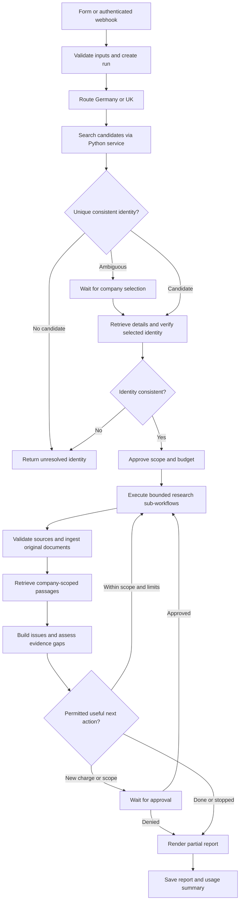

# Day 2 architecture proposal: n8n orchestration, Python research services

Inspection date: 2026-11-10. This is a proposal, not a deployed change.
No paid provider requests or live workflow mutations were performed.

## Inspection results

The repository export `workflows/legalflow_workflow.json` has four connected
nodes: form submission, field mapping, OpenRegister company search, and identity
matching. Connections resolve to existing nodes. The workflow stops after the
matching node. The form carries company name, jurisdiction and financial opt-in.

Important gaps in the export:

- Both Germany and UK inputs route to the German OpenRegister search endpoint.
- A unique normalized name match is labeled `verified` without company-detail,
  register-number, jurisdiction or court checks. It is only a candidate match.
- No explicit input validation or required-field flags protect the code node's
  direct `company_name.trim()` call. An offline missing-name fixture raises TypeError.
- Ambiguous/not-verified statuses have no connected review or termination branch.
- There are no external research, ingestion, retrieval, planning, report or
  approval nodes, nor workflow-level offline fixtures or execution tests.
- The HTTP node declares Header Auth but contains no credential reference in the
  export. This does not establish whether credentials are bound in the live instance.
- Its direct provider request bypasses Python's usage tracker, cache and budget gate.

A read-only local n8n API GET was attempted using the configured credential,
without printing it. The connection failed before an HTTP response. Consequently
live workflow versions, activation state, n8n version and credential bindings
have not been verified. No execution, activation, creation or update was attempted.

Python is a reusable prototype, currently invoked through an interactive CLI:

| Existing component | Reuse | Required Day 2 change |
| --- | --- | --- |
| `company_search.py`, `german_register.py`, `companies_house.py` | Register adapters and details | Noninteractive, jurisdiction-specific service operations |
| `company_research.py` | Identity-focused Tavily query and normalized excerpts | Typed research topics and explicit search coverage |
| `evidence_validator.py` | Consistency/date checks; unrelated-source exclusion | Separate candidate selection from record consistency and substantive verification |
| `financial_analysis.py`, `accounts_parser.py`, `financial_errors.py` | Deterministic figures, ratios, conservative error handling | Expose structured financial results without CLI prompts |
| `financial_cache.py` | Existing financial response files | Preserve format; report age and require approved refresh policy |
| `api_usage.py` | Approval, budget checks, cache and usage events | Durable run reservations, idempotency and request-local state |
| `due_diligence.py`, `report_renderer.py` | Issues, document requests, deterministic final classification | Accept retrieved evidence and validated claim records |
| `legalflow_agent.py` | Existing CLI and offline behavior | Retain compatibility; do not make it n8n's full-pipeline execution target |

There is no HTTP service, document corpus, retrieval index, embedding pipeline,
claim/citation validator or bounded research planner in the inspected repository.
OpenAI currently returns only allowlisted follow-up IDs, not an autonomous plan
or free-form legal analysis. The deterministic risk classification is currently
always Undetermined. The README's introductory status and diagram are stale:
later sections describe implemented evidence and financial checks that the
introduction still lists as planned.

The tracker uses a module-global runtime and an in-process lock. It cannot
safely isolate simultaneous HTTP sessions or enforce limits across restarted
Python processes or n8n workers. A fresh service request must not create a new
budget for the same due diligence run.

## Responsibilities and execution flow

n8n remains responsible for triggers, run state transitions, jurisdiction
routing, approvals, sub-workflow order, fan-out/join, bounded iteration and report
delivery. Python provides small typed operations, deterministic checks, document
processing and provider access. Every potentially paid operation, including
planning and embeddings, goes through the same Python cost/idempotency gate.

Proposed n8n graph:

Use named sub-workflows for Identity, Research, Documents/Retrieval, and Reporting.
The graph and endpoints below are proposed contracts, not installed services or
confirmed available node versions on the local instance.

## Service boundary and durable state

Add a small HTTP adapter, for example FastAPI, around existing functions. Keep
current CLI entry points. Avoid shelling out to the complete interactive CLI
from an Execute Command node; that would put orchestration back into Python.

Suggested operations:

| Proposed operation | Inputs/outputs |
| --- | --- |
| `POST /v1/runs` | Create run with requested identity, jurisdiction, scope, limits and execution mode |
| `POST /v1/runs/{id}/company/search` | Candidate list; no automatic ambiguous selection |
| `POST /v1/runs/{id}/company/verify` | Selected provider ID plus details; structured identity/consistency checks |
| `POST /v1/runs/{id}/research/search` | Allowlisted topic and validated identity; evidence references and coverage |
| `POST /v1/runs/{id}/financials` | Existing financial adapter/cache and deterministic analysis |
| `POST /v1/runs/{id}/documents/ingest` | Bounded approved document references; document/chunk IDs |
| `POST /v1/runs/{id}/retrieval/query` | Company-scoped passages with provenance, or explicit no-results |
| `POST /v1/runs/{id}/research/plan` | Allowlisted proposed actions and stop rationale; no direct tool execution |
| `POST /v1/runs/{id}/report` | Validated evidence and claims; deterministic report artifact |
| `GET /v1/runs/{id}` | State, coverage, usage estimates, pending/uncertain operations and errors |

Each mutating service operation carries a stable idempotency key based on run,
operation and canonical input hash. Return typed results containing run ID,
operation ID, status, evidence IDs, timestamps, cache metadata, usage estimates,
verification status and safe diagnostics. Do not put keys in JSON payloads.

Use SQLite transactions for a single-instance Day 2 store, with separate tables
for runs, approved scopes, operation reservations, evidence, documents, chunks,
claims and usage. PostgreSQL can replace it for multiple workers later. Enforce
a unique operation key, reserve budget atomically, and persist pending state
before contacting a provider. A transport timeout leaves an uncertain operation;
repeat execution must return existing state rather than issue another paid call.
If a worker crashes, reconcile uncertain work explicitly. Read-only status polls
must never restart provider work.

Replace global runtime switching with explicit per-run service context. Retain
JSON cache readers and the financial cache rather than discarding existing data.
Cache hits consume no new provider budget, but return original retrieval times
and stale-data flags. A new run must not erase session limits. A session is an
explicit durable grouping, not merely the lifetime of one HTTP handler.

Bind n8n to the service with authentication stored in its credential manager.
Verify host/container networking before choosing a service URL; container
localhost may not reach a Python service on the host. Do not bind the research
service publicly by default. n8n credential references should never be exported
with secret values. Paid provider HTTP nodes must not bypass the shared gate.

## Company verification and external research

1. Require company name and jurisdiction; accept registration number, court,
   address and known provider ID as optional identity constraints.
2. Route Germany to OpenRegister and UK to Companies House. Exact name is a
   candidate-selection signal, not proof of identity or verified legal standing.
3. Retrieve selected company details. Compare legal registration number, court
   where applicable, jurisdiction and name. Distinguish provider IDs from legal
   registration numbers; require review for conflicting identifiers.
4. Return separate states: candidate, selected, register-consistent, ambiguous,
   mismatch, unavailable. Retain source provenance and original API timestamps.
5. Expose a small research-topic allowlist: litigation, insolvency, regulatory
   matters and financial publication coverage. n8n decides which approved topics
   to invoke; avoid dozens of keywords in one query or unrestricted model URLs.
6. Search with exact identity and jurisdiction; use registration/court constraints
   when useful. Preserve query coverage, rejected results and rejection reasons.
   A negative narrow query does not establish no proceedings or low risk.
7. Fetch selected original documents only after identity and fetch-policy checks.
   Snippets remain leads. Official hosting alone does not verify the content or
   establish litigation status. A financial 404 is provider/request evidence,
   never proof that financial figures have not been published.

Existing integrations are sufficient for Day 2; do not add another paid search
provider merely to increase the integration count. Refreshes, document retrieval,
planning and embeddings require scope/budget checks before execution.

## Retrieval-augmented generation (RAG)

Implement ingestion and retrieval as independent services called by n8n:

- Begin with uploaded or already approved original documents, not an index of
  unverified search snippets labeled as verified. Keep evidence classes distinct.
- Extract bounded text, retain source and retrieval/publication timestamps,
  content hash, page/section, language, reporting period and entity/scope metadata.
  Unsupported/scanned PDFs explicitly require OCR or manual review.
- Assign stable document and chunk IDs. Do not merge different companies or
  standalone/consolidated statements. Reject URL fetches to internal addresses;
  limit MIME types, size, redirects and document counts.
- Start with SQLite full-text retrieval for deterministic offline development.
  This supports document-grounded generation without introducing embedding fees.
  Add a persistent vector index only if evaluation demonstrates a benefit. Local
  embeddings are an option; paid embedding calls require explicit approval,
  verified estimates and model/version-aware caching.
- Filter every retrieval by run/authorized corpus and canonical company identity
  before ranking. RAG results include verbatim passages, chunk IDs and location
  metadata. No retrieval hit means insufficient evidence, not a model guess.
- If a model proposes claims, require structured claim text, supporting chunk IDs,
  allegation/finding status, dates and uncertainty. Validate that IDs belong to
  the selected corpus and that quoted passages actually exist. Citation presence
  alone does not verify entailment or legal significance; ambiguous claims need
  review. Never let retrieved content override system instructions.
- Initially surface retrieved passages and reviewable proposals in the issues
  list while preserving the deterministic final classification. Do not replace
  the safe renderer with unvalidated free-form model conclusions.

## Bounded autonomy and approvals

The planner may suggest only allowed action IDs and validated arguments. n8n
checks proposed actions against approved scope, remaining budget, evidence gaps,
previous attempts and iteration limits, then chooses the next transition.
Python validates inputs and reserves usage but does not recursively run the plan.

For an initial Day 2 configuration, propose at most two research iterations,
three topic searches and two selected document fetches. These are configurable
planning caps, not newly authorized requests. Stop for identity mismatch,
exhausted budget, unknown monetary estimates under a finite cap, no new evidence,
repeated failed operation, unresolved provenance, denied approval or elapsed time.

Store approvals with scope, price/credit estimate and expiry. Approval never
raises a configured hard limit implicitly. Disable automatic retries of paid
HTTP tools in n8n as well as SDK retries. Workflow retries reuse idempotency keys.
An approval wait resumes the same durable run rather than rebuilding its budget.
On partial failures, report completed coverage and specific gaps rather than
marking the entire company as risky or returning a misleading complete report.

## Implementation order and acceptance checks

1. Correct intake/routing/candidate labels and add explicit unresolved-identity
   branches in a new inactive draft export. Preserve the original/live workflow.
2. Add typed Python service operations and durable run/idempotency/budget state;
   route the existing n8n search node through that boundary.
3. Wire provider sub-workflows, financial opt-in, cache metadata and partial-failure
   branches. Maintain current 404 and unavailable-vs-unpublished distinctions.
4. Add document ingestion, offline retrieval, citation/provenance checks and an
   evidence-backed issues list.
5. Add a bounded planner that proposes actions; n8n owns the loop and approvals.
6. Export/review a concrete draft, then obtain approval before importing,
   activating or modifying any live n8n workflow. Obtain separate approval before
   any paid integration acceptance test.

Day 2 is complete when a synthetic Germany and UK form submission traverses the
n8n draft end to end, returns identity outcomes, evidence and retrieval citations,
issues and a single deterministic final classification, with no external calls.
Ambiguous identities pause, missing documents remain explicit, unknown costs
block capped operations, duplicate workflow delivery does not rebill, and resumed
runs retain spending. Provider mocks cover 401/403/404/429/timeouts and malformed
responses. Retrieval tests cover wrong-entity exclusion, no-hit behavior,
duplicate documents, invalid citation IDs and untrusted document instructions.
The original CLI and all existing offline tests must continue to pass.

## Checks performed for this proposal

- Existing offline Python suite: 91 tests passed; tests block socket connections.
- Export structure: JSON readable; all connection references resolve.
- Offline execution of exported identity JavaScript with Node: a single name match
  becomes verified, ambiguity remains ambiguous, UK takes the same identity path,
  and a missing name raises TypeError. These demonstrate current gaps, not fixes.
- Live n8n inspection: connection failed; activation/version/credentials unverified.
- No implementation code or workflow changes made as part of this inspection.

## Relevant official n8n documentation

- [Sub-workflows](https://docs.n8n.io/flow-logic/subworkflows/): modular orchestration.
- [RAG](https://docs.n8n.io/advanced-ai/rag-in-n8n/): separate document ingestion and retrieval.
- [Human review for tools](https://docs.n8n.io/advanced-ai/human-in-the-loop-tools/): approval-gated tool execution; verify availability on the installed version.
- [Public API authentication](https://docs.n8n.io/api/authentication/): read-only inspection uses the configured API key header.
