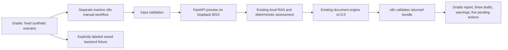

# INCEPT: one-command local demonstration

## Launch

From the repository root, in the installed backend environment:

```sh
python -m scripts.gradio_app
```

Exact command tested on this machine:

```sh
conda run --no-capture-output -n bootcamp-env python -m scripts.gradio_app
```

Open **http://127.0.0.1:7860**. Keep the terminal running; stop with Ctrl+C. This starts Gradio and an isolated FastAPI helper on **127.0.0.1:8010**. Existing services on 8000/8002 and historical workflows are not modified. If 7860 is occupied, use `--port 7861`. An unrelated service on 8010 is never stopped or silently reused; n8n execution is blocked and saved mode stays available.

Prerequisites: install `requirements.txt` in the selected Python environment; Node.js and the existing local n8n installation must be available for a fresh orchestration run. n8n must be running at http://127.0.0.1:5678, with its existing `N8N_API_KEY` available privately in `.env` or the process environment. Do not paste keys into Gradio. No Google OAuth setup or paid provider credential is needed for this demo. The app never edits `.env`.

The launcher finds an installed n8n executable; it never invokes npx to download software. If multiple cached installations exist, set `INCEPT_N8N_CLI` to the existing n8n `bin/n8n` path before launch. This is server configuration, not a UI input. Local macOS/Linux execution uses a file lock; Windows CLI support is not implemented.

## Two clearly distinct modes

**Run DEMO through n8n:** the UI imports a separate inactive manual ten-node workflow on first use, then executes only that exact reviewed graph using the installed n8n CLI. It has no Gmail, Calendar, Sheets, registry, financial or model nodes. The real FastAPI endpoint builds/persists the synthetic matter, retrieves local legal references and generates v2 drafts. n8n validates inputs, source links, arithmetic, documents and approval states before producing its persisted execution summary. Gradio requires an actual new successful execution trace; an old success cannot count as a new run.

**Load saved DEMO fixture:** always displays `SAVED SYNTHETIC DEMO FIXTURE — not a new n8n or AI execution`. The versioned bundle in `examples/gradio_demo/bundle.json` was generated by the real onboarding engine from the adjacent synthetic `intake.json`. This mode needs neither n8n nor paid APIs. Errors in a fresh run show an explicit error notice and the saved fixture, without claiming live success. Invalid fixtures are withheld.

The scenario is fixed: fictional INCEPT DEMO GmbH, fictional Nordlicht Projektservice GmbH, disputed EUR 18,750 services invoice. No real company or person is contacted. Authority and claim merits remain unverified. The five-hour advance uses the explicit demo calculation: EUR 1,250 net + EUR 237.50 VAT = EUR 1,487.50. The advance request is NOT_READY_FOR_ISSUANCE; the three drafts remain unapproved.

## Architecture



n8n remains the orchestrator of the claimed fresh run. The UI does not call preview directly to fabricate an orchestration result. The isolated helper disables model/extraction opt-ins, denies outbound socket connections and exposes only the existing health/preview routes. No new provider/research API or document engine was added. UI controls cannot change workflow IDs, URLs, CLI commands or payloads. There is no approve, issue, send or schedule button. Requests use a private runtime lock and one fixed backend idempotency key.

Files: `scripts/gradio_app.py` (presentation/launcher), `scripts/demo_runtime.py` (guarded local execution), `scripts/demo_workflow.py` and `workflows/incept_gradio_demo.json` (reused structured workflow). Raw execution traces/CLI logs and SQLite persistence are under ignored `data/gradio_demo/`. The interface shows only synthetic output and sanitized provenance, not tokens or raw private traces. This is a loopback demonstration, not a public production deployment.

## Actual verification

Gradio's real HTTP/queue `/run_demo` callback completed n8n execution **38**, workflow `l430btlFiBP5bYQB`, successfully. Restart-and-repeat execution **39** also passed, reused the same matter and preserved identical documents/advance amounts. All eight output panels were returned, with a real backend report, three v2 document previews, validation, pending actions and execution provenance. The `/load_saved` callback separately returned the labeled fixture without claiming an execution. Zero provider requests, outgoing emails, Calendar/Sheets writes, mandate acceptances or invoice issuances occurred.

Sanitized evidence: [demo verification](gradio_demo_validation.json). Private full output is preserved locally under ignored `reports/incept_gradio_demo/` and `data/gradio_demo/`; it is not committed. No existing workflow is activated or overwritten.

## AI and Project 3 claims

The reliable demo is structured intake plus local RAG and deterministic report/document generation. It is not a new live AI or three-Google-API run. Natural-language extraction and source-exact synthesis v2 remain separate experimental capabilities. Real extraction returned usable source-grounded data after deterministic grounding; the last live synthesis was rejected in execution 34. Version 2 passes offline mock tests, but has no accepted live synthesis yet.

Use the [5–7 minute script](demo_script.md) and [accurate checklist](../PROJECT3_SUBMISSION_CHECKLIST.md). Explain recorded live Google/research evidence separately. Do not claim that today's no-network DEMO alone proves live autonomous research or an accepted AI-written assessment.
