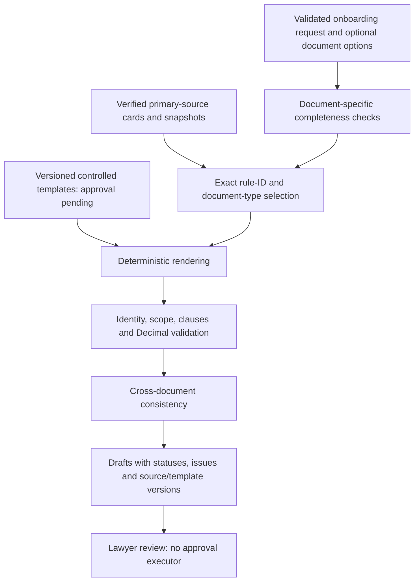

# German legal draft generation v2

All output is DEMO / DRAFT / REQUIRES LAWYER REVIEW. No document is issued, signed, sent, booked or legally approved by this service. No LLM or paid API participates in generation.

## Source hierarchy and architecture



The [source index](legal_document_sources.md) links each provision. `references/legal_documents/corpus.json` records 32 official source checks made on **2026-11-11**, original URLs, UTC retrieval timestamps, body/snapshot hashes, drafting requirements and limitations. Consolidated statutory text was checked; retrieval date is not claimed to be enactment date or proof of applicability to a past/future transaction. Statutory snapshots and short BMF support excerpts are local. `source_kind` distinguishes legislation from administrative guidance. The BMF FAQ is guidance, not legislation.

`DocumentRules` reuses `LocalRAG`'s reference/chunk integrity and citation metadata. Selection uses the template's exact legal-rule allowlist plus document-type tags. It does not retrieve unrelated semantic matches. BGB §§164–181 were checked for context; only relevant drafting cards are selected for the power. Existing mandate/corporate corpora are not merged into the document rule store. Tavily results are never legal rules. Templates, mandate facts and optional assistance remain separate; language-model refinement is intentionally absent.

`templates/german_legal/v2/` holds three independent Markdown templates and a manifest with version **2.0.0**, pending production approval, allowed ancillary powers (none), template digests and pinned corpus digest. `scripts/legal_documents.py` renders facts and controlled conditional wording, calls separate validators and cross-checks the result. Missing/corrupt sources or templates fail closed through the existing safe onboarding error handler. Tampered document text is rejected against the controlled rendering; this is structural integrity validation, not a semantic legal opinion.

## Structured input

The existing `POST /v1/onboarding/preview` remains. Client, firm, matter and fee fields retain their meaning. An optional `document_options` object adds:

- Explicit representation scope: unspecified, out-of-court, court or both. This template grants only the proposed limited out-of-court scope; court/ancillary requests are flagged and not granted.
- Corporate representative name, role, authority status and evidence reference. `synthetic_evidence_checked` requires a stated fictional evidence reference and is never real-world verification.
- Separate engagement-law input; substantive governing law and registry location do not prove applicable fee/power law.
- Place, invoice number/date and a supplied payment date (if any). Future receipt dates are rejected as a completed payment claim.
- Typed firm policy: supplied net hourly rate, billing method/unit, time documentation, expenses, payment terms, other-professional terms, tax identifier, payment instructions and explicit demo tax-configuration acknowledgement.
- Recipient consumer/business classification, domestic-establishment flags and optional prior-year turnover category for review. These do not establish a tax exemption or e-invoice eligibility automatically.

Supplied firm policy is **unverified draft configuration**, not a caller-controlled legal approval. There is no API to grant approval or issue documents. The examples' payment/billing terms are explicitly authored synthetic policy inputs; they are not defaults imposed on legacy intake. Only the named lawyer/rate is supported by the calculation; other professionals require separately supplied/reviewed terms. Tax and bank data are never invented.

See `examples/documents/{individual,corporate}/input.json` for reproducible payloads. Use a new idempotency key for a changed draft revision. Legacy requests with no document options retain their original fingerprint; stored previews replay their original content, with legacy document-version defaults. They are not silently upgraded or relabeled as v2. New documents explicitly identify v2 and source version.

## Documents and readiness

- **Vollmacht:** separate principal, representative, law firm, lawyer, matter and counterparty; limited authority; no default settlement, receipt of funds, delegation, §181 exemption or litigation authority; place/date/authorization fields. No fee-agreement clause is embedded.
- **Vergütungsvereinbarung:** separate heading/parties, net and conditional gross rate, supplied billing/time/expense/payment terms, conditional crediting of advances, statutory-remuneration distinctions, protected reimbursement notice and acceptance fields. Text form is not presented as a universal wet-ink signature requirement. RVG §§3a/4/4b/34 and BRAO §49b exceptions require review; not every defect has the same consequence.
- **Vorschussanforderung:** future work only, five-hour calculation reused from the existing Decimal function, issuer/recipient, fiscal/invoice placeholders, conditional tax, payment data only if supplied, receipt-date caveat and separate final-billing/e-invoice review. A draft label does not by itself prevent invoice effects if used externally.

Each `DraftDocument` retains `kind`, `state=pending_lawyer_approval`, and `content_markdown`, and adds version/provenance, `validation_issues`, `missing_information`, `lawyer_review_questions`, `legal_source_ids`, `completeness_status`, `ready_for_issuance=false` and `legally_approved=false`.

| Status | Meaning |
|---|---|
| DRAFT_COMPLETE_FOR_LAWYER_REVIEW | Structured draft inputs complete; no legal approval |
| MISSING_INFORMATION | Required drafting terms or identity fields unresolved |
| LEGAL_REVIEW_REQUIRED | Explicit scope/applicability/authority issue remains |
| NOT_READY_FOR_ISSUANCE | Advance remains a non-issued draft; fiscal data/form/review unresolved |
| GENERATION_FAILED | Conflicting identities/calculations/policy data or tampered document; usable body withheld |

Negative validators check edited identities, scope, unauthorized clauses, fee amounts, missing mandatory notice, invoice metadata and cross-matter contamination. Exact matching deliberately requires any subsequent drafting change to be reviewed and regenerated; the system does not certify arbitrary lawyer-edited prose. Consumer information/withdrawal questions, professional conflicts, fee appropriateness, procedural/form requirements and tax treatment remain external professional review tasks.

## Tax and e-invoice limits

The 19% demonstration is an explicitly supplied scenario: 5 × EUR 250 net = EUR 1,250; VAT EUR 237.50; gross EUR 1,487.50. Unknown tax leaves VAT/gross unavailable, not zero. A supplied exemption remains unverified. RVG §9 governs an appropriate advance; RVG §10's current text-form calculation is distinguished from a final bill. UStG §§12/13/14/19/27 and BMF FAQ support the review questions.

The invoice assessment separates consumers from specified domestic B2B cases and flags the 2025/2026 and conditional 2027 transitions (including the prior-year EUR800,000 condition and EDI). Actual supply/payment/issue dates, consent and exceptions still require checking. No exemption is confirmed from the draft date alone. Markdown/PDF is not a structured e-invoice; no XRechnung/ZUGFeRD exporter or compliance certificate was added.

## Reproduce and update safely

```sh
python -m scripts.document_examples
python -m unittest discover -s tests -p test_legal_documents.py -q
python -m unittest discover -s tests -q
```

Each of the two generated bundles includes three Markdown drafts, input JSON, structured validation and a lawyer checklist. Both authority/fee drafts are complete for review. Both advances intentionally lack a genuine tax identifier, unique invoice number and issuance date and remain NOT_READY_FOR_ISSUANCE. No genuine payment credentials appear. Markdown is the only implemented output; financial PDF ingestion and its pypdf dependency are retired.

Before updating a template: review the primary source and temporal applicability; record URL/retrieval/hash; amend the document-specific rule card and relevant allowlist; change template version and manifest digests; keep production approval pending until professional review; regenerate samples; run tampering, cross-document, idempotency, endpoint and full regression tests. Never update live workflows or old evidence as part of this process. Bump document versions for materially changed wording and preserve persisted historical bundles.


## Actual loopback HTTP validation

The development helper on 127.0.0.1:8003 was restarted with updated code and paid APIs disabled. Port 8002 and all existing workflows were preserved. Both synthetic cases returned HTTP 200, all three template-v2.0.0 drafts, matching party/matter links and EUR1487.50 gross under the explicit demo VAT configuration. Idempotent replay returned the same bundles; the existing n8n response validator accepted the actual HTTP responses. This is real local HTTP validation, not a new n8n execution or legal approval.

A conflicting policy rate produced GENERATION_FAILED for fee/advance documents, with the matter and all actions still pending lawyer review. Approval/issuance/send routes returned 404, and an injected issuance option returned 422. No invoice was issued. The templates remain production-unapproved, even where data completeness passes.

[Sanitized HTTP evidence](legal_document_http_validation.json). Full responses and generated HTTP drafts are private in reports/document_http_validation. Final regression suite: **315 tests passed**, including **20 document-specific tests**.
