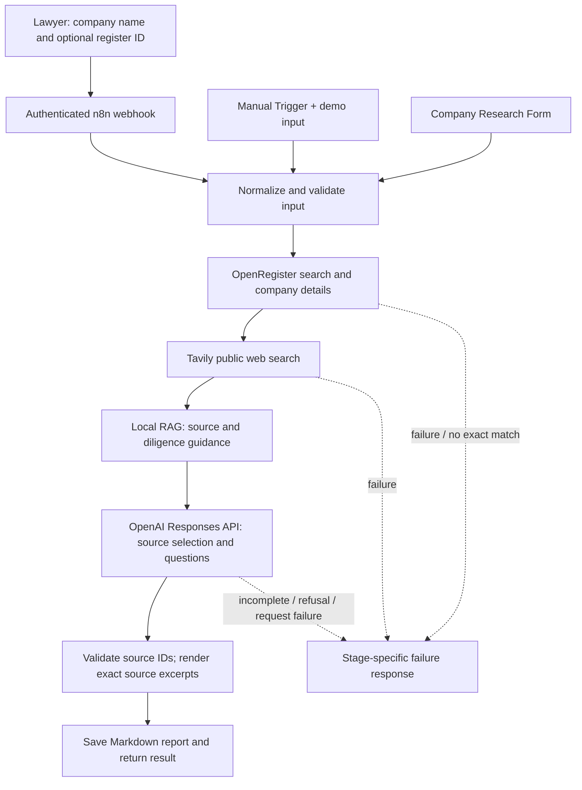

# CompanyScope — Autonomous Company Research and Report Generation Agent

**Company research, made simple.**

Research German companies using official registry data, public web sources and AI-assisted analysis. Generate structured, source-referenced company reports in one workflow.

## Problem and target user

CompanyScope is an autonomous company research and report generation agent for lawyers preparing an initial meeting with a German corporate client or researching a commercial counterparty. It automates a bounded public-source briefing using official registry data, public web sources and AI-assisted analysis.

The output is **not a legal opinion**, conflict check, sanctions screen, solvency conclusion, or proof of authority.

## Architecture



The user-facing product is CompanyScope. Its existing n8n workflow remains **INCEPT — Company Research Agent** (ID `61tsMgiWvpjit2st`) as the stable technical workflow name and identifier. That one permanent active workflow serves manual runs, the CompanyScope production form, and `POST /webhook/ironhack-company-research`. All three inputs feed the same normalizer and research pipeline. Provider calls have automatic retries disabled. The response reports a failed stage instead of substituting mock or demo data.

OpenAI uses a versioned corporate-intelligence prompt and strict Structured Outputs schema to produce cited company analysis, public findings, analytical observations, information gaps, and research actions. The report renderer builds fixed Markdown headings and validates that every model claim has a known evidence ID. Registry facts are rendered from OpenRegister; web findings remain explicitly labeled unverified leads. Source-ID validation cannot automatically prove that every cited source semantically supports every sentence, so the report says that professional review is required.

### Research quality and report structure

The synthesis instructions are versioned in [`prompts/corporate_intelligence_v1.md`](prompts/corporate_intelligence_v1.md). Tavily receives one focused query combining the exact registered name, registered location, business purpose, and request for company pages and recent developments. Its HTTP status, raw result count, accepted count, and rejection reasons are retained in run metadata. The parser is dependency-free because n8n Code nodes do not expose the global `URL`; it filters unsafe URLs, company-name collisions, duplicate pages, and unrelated content, and assigns stable `WEB-1`… IDs only to retained results. A matching domain is treated as a candidate, not proof of legal ownership.

Reports use these fixed sections: Executive Summary; Company Profile; Business Model and Market Position; Public Findings and Developments; Analytical Observations; Information Gaps; Recommended Research Actions; Sources and Limitations. The renderer escapes model-supplied Markdown punctuation and line breaks, decodes common HTML entities, and does not overwrite earlier reports. Sparse evidence produces a shorter report and explicit limitations.

### Why n8n instead of LangGraph

n8n is the primary stack because this project is a small, visible tool-orchestration workflow: a user starts one run, the graph calls three external APIs, branches on provider and identity failures, and returns a report. Its editor exposes the sequence and credentials to a reviewer. LangGraph would add application code for graph state and tool routing without improving this MVP’s few deterministic steps. The report validator and renderer are ordinary Code nodes, not a second orchestration framework.

## APIs and reference retrieval

| Tool | Use | Evidence handling |
|---|---|---|
| OpenRegister API | Autocomplete exact registered company; retrieve details | Legal name, register ID/court/type, legal form, address, purpose, status, retrieval time |
| Tavily Search API | Search the registered name, location, business purpose, company pages and recent developments | Sanitized URLs and dates retained; only relevant results receive stable IDs; snippets are unverified leads |
| OpenAI Responses API (`gpt-4o-mini`) | Produce cited company-specific analysis, findings, gaps and follow-up actions | `store:false`, strict JSON schema, completed status required; source-ID checks retained |
| Local RAG | Select source-reliability, corporate identity and meeting-preparation guidance | Static `reference_corpus.json`; never treated as company-specific evidence |

OpenAI Structured Outputs use the Responses API’s JSON Schema format, which is supported by `gpt-4o-mini`. See [OpenAI Structured Outputs](https://developers.openai.com/api/docs/guides/structured-outputs?api-mode=responses) and [Responses API create reference](https://developers.openai.com/api/reference/resources/responses/methods/create).

OpenRegister and Tavily API calls can consume provider credits. This project does not purchase credits, change billing, or enable automatic retries. Provider account usage should be checked separately from the workflow’s reported usage fields.

## Setup

Run commands from the repository root. Keep API keys in the ignored root `.env`; never paste them into the workflow or commit them.

1. Install only this project’s local runner dependencies:

   ```sh
   python -m pip install -r projects/ironhack_project3/requirements.txt
   ```

2. Configure these names in the ignored repository `.env`:

   ```dotenv
   N8N_BASE_URL=http://127.0.0.1:5678
   N8N_API_KEY=…
   OPENREGISTER_API_KEY=…
   TAVILY_API_KEY=…
   OPENAI_API_KEY=…
   ```

   The n8n API key must be allowed to create credentials and workflows. The deployment script adds `PROJECT3_WEBHOOK_TOKEN` and `PROJECT3_WORKFLOW_ID` locally. It creates new n8n credentials named `Ironhack Project 3 …`, limited to the three provider hosts, and does not modify existing credentials.

3. Start the existing n8n installation with access restricted to its normal files folder and this project's report folder, then create/update and activate the single workflow:

   ```sh
   N8N_RESTRICT_FILE_ACCESS_TO="~/.n8n-files;$PWD/projects/ironhack_project3/reports" n8n start
   python projects/ironhack_project3/deploy_workflow.py
   ```

   If n8n is already running, stop that same process before starting it with the additional reports-folder allowance. The workflow's disk-write node can write only under the explicitly allowed reports folder.

   This is an administrative setup command. It updates the same exact-name workflow on later runs rather than creating a new workflow.

4. Run research manually in n8n:

   - Open `http://localhost:5678/workflow/61tsMgiWvpjit2st`.
   - Click **Execute workflow**. The Manual Trigger starts the shared pipeline with the default company **SAP SE**; the optional register identifier is blank so exact-name matching can resolve its registry record.
   - To change the demonstration company, open **Set Demo Company** and edit `company_name` and, when known, `register_identifier`.
   - On success, inspect the **Report Output** node for the structured result and Markdown; the workflow also writes the file to `projects/ironhack_project3/reports/INCEPT-<company>-<execution-id>.md` on the n8n host. On failure, inspect the terminal `Error: …` node and the execution log for the precise stage/code.

5. Use the browser form while the workflow is active:

   - **Production form URL:** `http://localhost:5678/form/incept-company-research` (use the Production URL; the test URL is only for n8n editor testing)
   - Sign in to the n8n instance with a user that can execute this workflow, then enter a company name and submit. The required company-name field and optional register-number field map to the shared input. A unique exact OpenRegister match continues automatically. When exact matching fails but plausible registry candidates are present, the form returns a numbered list with registered name, register number, and court. Restart with the exact registered name; if the name is duplicated, provide its register number. Candidate suggestions are never selected automatically. No matching candidates produces a clear not-found response.
   - The form requires n8n user authentication and workflow execute permission, so an unauthenticated visitor cannot trigger paid research.

6. Run through the existing authenticated webhook (no workflow is created per request):

   ```sh
   python projects/ironhack_project3/run_research.py "SAP SE" --register-identifier "HRB 719915"
   python projects/ironhack_project3/run_research.py "Siemens Healthineers AG" --register-identifier "HRB 237558"
   ```

   Each request executes the active webhook workflow. The runner saves a timestamped Markdown report and credential-free `.meta.json` under `projects/ironhack_project3/reports/`. A failed step is reported without automatic retry; no partial output is represented as a complete report.

The deploy script exports `workflow.json` without credential values or credential references. Importing that sanitized export alone is not sufficient to run it; use the deploy script to bind n8n credentials.

## Actual verification runs

The workflow deployed in the current local n8n workspace has ID `61tsMgiWvpjit2st`. Both reports below came from this same workflow ID:

| Company | n8n execution | Model | OpenAI status | Usage | Result |
|---|---:|---|---|---|---|
| SAP SE | 272 | `gpt-4o-mini-2024-07-18` | completed | 3,524 input / 174 output tokens | source validation passed |
| Siemens Healthineers AG | 273 | `gpt-4o-mini-2024-07-18` | completed | 3,263 input / 178 output tokens | source validation passed |

The reports are [SAP SE](reports/20261112T080627Z-sap-se.md) and [Siemens Healthineers AG](reports/20261112T080643Z-siemens-healthineers-ag.md). Their `.meta.json` files contain the execution ID, model usage, source URLs, and validation result. A separate missing-company test returned execution 274 with `exact_company_match_not_found`; it stopped before Tavily and OpenAI.

The Manual Trigger was verified with SAP SE on execution 277: `gpt-4o-mini-2024-07-18` completed with 2,241 input and 123 output tokens, and source validation passed. Its report-save step initially hit n8n's file-access restriction; execution 278 resumed from that failed save node only and completed the report output without repeating any provider request. The generated file is [INCEPT-SAP-SE-277.md](reports/INCEPT-SAP-SE-277.md). Authenticated webhook execution 279 returned `invalid_company_name` for a deliberately invalid short input, confirming that the preserved webhook responds through the new last-node response mode without calling any provider.

The production company form is `http://localhost:5678/form/incept-company-research`. Its field mapping, shared-pipeline route, report/error completions, candidate fallback, and layout are covered by offline tests. Unauthenticated production-form GET redirected to n8n sign-in and unauthenticated multipart POST returned HTTP 401 without creating an execution. A signed-in browser submission was not tested in this environment.

The quality-upgrade run for Shapesty GmbH used the same workflow ID and produced n8n execution **283**. OpenRegister selected the exact company name, Tavily returned HTTP 200 with 8 raw results and the parser retained 5 public-web candidates, and Local RAG supplied 3 methodology cards. OpenAI `gpt-4o-mini-2024-07-18` completed (3,908 input / 877 output tokens). The live execution stopped at the legacy `uncertainties` question-mark check, so it did not save a report. After removing that obsolete punctuation condition while retaining text bounds and citation-ID checks, the saved execution #283 response was replayed locally through the current validator and renderer: it passed source-ID/citation-presence validation with 6 sources and rendered the fixed Markdown sections. This offline replay is not a second live run; no new report is presented as a production-generated artifact. Semantic entailment remains a lawyer review responsibility.

Company facts in the reports are exact excerpts from the selected registry or web evidence, with source IDs shown beside them. Public web snippets are not independently verified, and the search is not exhaustive. One early output draft was superseded after finding a register-field mapping issue; only the corrected SAP report is included.

## Limitations

- Search coverage and provider availability can vary. No search result does not prove that no relevant event exists.
- Tavily content is a discovery lead, not a verified statement about the company.
- OpenRegister fields are provider-reported public registry data; the workflow does not independently certify freshness or legal effect.
- The RAG corpus is a small methodology checklist, not law or company evidence.
- The model does not provide a legal opinion, risk rating, conflict result, sanctions result, or financial analysis.
- PDF, Gmail, Gradio, account management, and legal mandate workflows are intentionally out of scope.

## Files

- `workflow.json` — sanitized n8n export.
- `build_workflow.py` — deterministic workflow and export builder.
- `deploy_workflow.py` — explicit, idempotent workflow/credential setup.
- `run_research.py` — authenticated invocation and local report saving.
- `reference_corpus.json` — small static RAG corpus.
- `architecture.mmd` — architecture diagram source.
- `tools.md` — provider and validation details.
- `gtm_future_sprints.md` — proposed GTM plan; no experiments are claimed as completed.
- `demo_script.md` — timed 5–7 minute walkthrough.
- `submission_checklist.md` — requirement mapping.
