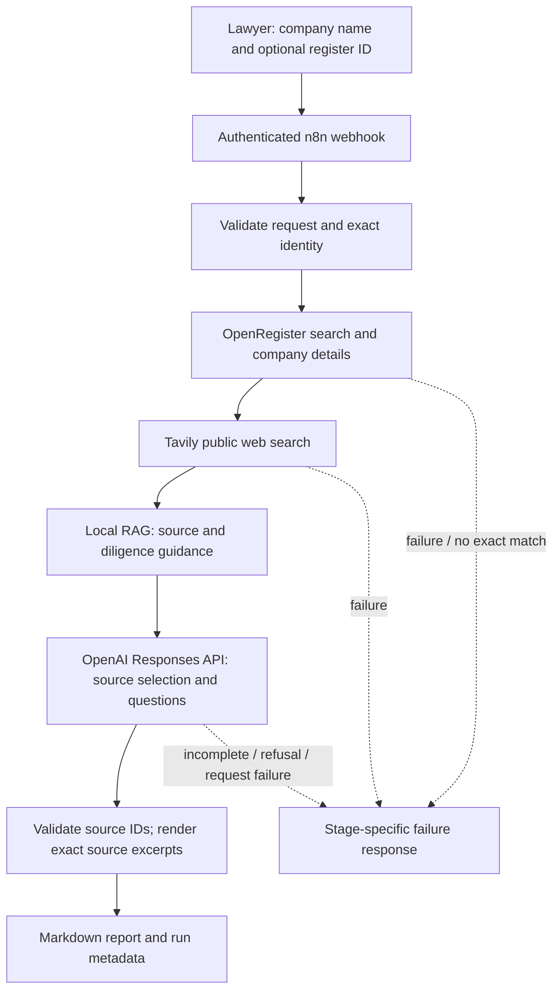

# INCEPT — Autonomous Company Research Agent

## Problem and target user

Lawyers preparing an initial meeting with a German corporate client or researching a commercial counterparty often have to gather registry identity, company background, recent public information, and research questions from separate tools. This MVP automates a bounded public-source briefing for that legal-services workflow.

The output is **not a legal opinion**, conflict check, sanctions screen, solvency conclusion, or proof of authority.

## Architecture



The n8n workflow is the only orchestrator. One permanent active workflow, **INCEPT — Company Research Agent**, serves all runs through `POST /webhook/ironhack-company-research`. Provider calls have automatic retries disabled. The response reports a failed stage instead of substituting mock or demo data.

OpenAI selects relevant source IDs and produces neutral uncertainty/follow-up questions. The workflow renders company facts as text copied from the OpenRegister record or Tavily result. It rejects unknown source IDs and does not let the model create factual report passages. Every web result is labeled an unverified lead; registry data and web leads remain separate.

### Why n8n instead of LangGraph

n8n is the primary stack because this project is a small, visible tool-orchestration workflow: a user starts one run, the graph calls three external APIs, branches on provider and identity failures, and returns a report. Its editor exposes the sequence and credentials to a reviewer. LangGraph would add application code for graph state and tool routing without improving this MVP’s few deterministic steps. The report validator and renderer are ordinary Code nodes, not a second orchestration framework.

## APIs and reference retrieval

| Tool | Use | Evidence handling |
|---|---|---|
| OpenRegister API | Autocomplete exact registered company; retrieve details | Legal name, register ID/court/type, legal form, address, purpose, status, retrieval time |
| Tavily Search API | Search website, products/services, public developments and recent coverage | URLs and timestamps retained; snippets are labeled unverified leads |
| OpenAI Responses API (`gpt-4o-mini`) | Select useful evidence sources and write neutral uncertainties/follow-ups | `store:false`, strict JSON schema, completed status required |
| Local RAG | Select source-reliability, corporate identity and meeting-preparation guidance | Static `reference_corpus.json`; never treated as company-specific evidence |

OpenAI Structured Outputs use the Responses API’s JSON Schema format, which is supported by `gpt-4o-mini`. See [OpenAI Structured Outputs](https://developers.openai.com/api/docs/guides/structured-outputs?api-mode=responses) and [Responses API create reference](https://developers.openai.com/api/reference/resources/responses/methods/create).

OpenRegister and Tavily API calls can consume provider credits. This project does not purchase credits, change billing, or enable automatic retries. Provider account usage should be checked separately from the workflow’s reported usage fields.

## Setup

Run commands from the repository root. Keep API keys in the ignored root `.env`; never paste them into the workflow or commit them.

1. Install only this project’s local runner dependencies:

   ```sh
   python -m pip install -r projects/ironhack_project3/requirements.txt
   ```

2. Configure these names in the ignored repository `.env`:

   ```dotenv
   N8N_BASE_URL=http://127.0.0.1:5678
   N8N_API_KEY=…
   OPENREGISTER_API_KEY=…
   TAVILY_API_KEY=…
   OPENAI_API_KEY=…
   ```

   The n8n API key must be allowed to create credentials and workflows. The deployment script adds `PROJECT3_WEBHOOK_TOKEN` and `PROJECT3_WORKFLOW_ID` locally. It creates new n8n credentials named `Ironhack Project 3 …`, limited to the three provider hosts, and does not modify existing credentials.

3. Start the existing n8n installation, then create/update and activate the single workflow:

   ```sh
   python projects/ironhack_project3/deploy_workflow.py
   ```

   This is an administrative setup command. It updates the same exact-name workflow on later runs rather than creating a new workflow.

4. Run a company research request:

   ```sh
   python projects/ironhack_project3/run_research.py "SAP SE" --register-identifier "HRB 719915"
   python projects/ironhack_project3/run_research.py "Siemens Healthineers AG" --register-identifier "HRB 237558"
   ```

   Each request executes the active webhook workflow. The Markdown report and credential-free `.meta.json` are saved under `projects/ironhack_project3/reports/`. A failed step is reported without automatic retry; no partial output is represented as a complete report.

The deploy script exports `workflow.json` without credential values or credential references. Importing that sanitized export alone is not sufficient to run it; use the deploy script to bind n8n credentials.

## Actual verification runs

The workflow deployed in the current local n8n workspace has ID `61tsMgiWvpjit2st`. Both reports below came from this same workflow ID:

| Company | n8n execution | Model | OpenAI status | Usage | Result |
|---|---:|---|---|---|---|
| SAP SE | 272 | `gpt-4o-mini-2024-07-18` | completed | 3,524 input / 174 output tokens | source validation passed |
| Siemens Healthineers AG | 273 | `gpt-4o-mini-2024-07-18` | completed | 3,263 input / 178 output tokens | source validation passed |

The reports are [SAP SE](reports/20261112T080627Z-sap-se.md) and [Siemens Healthineers AG](reports/20261112T080643Z-siemens-healthineers-ag.md). Their `.meta.json` files contain the execution ID, model usage, source URLs, and validation result. A separate missing-company test returned execution 274 with `exact_company_match_not_found`; it stopped before Tavily and OpenAI.

Company facts in the reports are exact excerpts from the selected registry or web evidence, with source IDs shown beside them. Public web snippets are not independently verified, and the search is not exhaustive. One early output draft was superseded after finding a register-field mapping issue; only the corrected SAP report is included.

## Limitations

- Search coverage and provider availability can vary. No search result does not prove that no relevant event exists.
- Tavily content is a discovery lead, not a verified statement about the company.
- OpenRegister fields are provider-reported public registry data; the workflow does not independently certify freshness or legal effect.
- The RAG corpus is a small methodology checklist, not law or company evidence.
- The model does not provide a legal opinion, risk rating, conflict result, sanctions result, or financial analysis.
- PDF, Gmail, Gradio, account management, and legal mandate workflows are intentionally out of scope.

## Files

- `workflow.json` — sanitized n8n export.
- `build_workflow.py` — deterministic workflow and export builder.
- `deploy_workflow.py` — explicit, idempotent workflow/credential setup.
- `run_research.py` — authenticated invocation and local report saving.
- `reference_corpus.json` — small static RAG corpus.
- `architecture.mmd` — architecture diagram source.
- `tools.md` — provider and validation details.
- `gtm_future_sprints.md` — proposed GTM plan; no experiments are claimed as completed.
- `demo_script.md` — timed 5–7 minute walkthrough.
- `submission_checklist.md` — requirement mapping.
